<p align="center">
<a href="../../README.md">English</a> | <a href="README.zh-CN.md">简体中文</a> | <a href="README.zh-TW.md">繁體中文</a> | <a href="README.ko.md">한국어</a> | <a href="README.de.md">Deutsch</a> | <a href="README.es.md">Español</a> | <a href="README.fr.md">Français</a> | <a href="README.it.md">Italiano</a> | <a href="README.da.md">Dansk</a> | <a href="README.ja.md">日本語</a> | <a href="README.pl.md">Polski</a> | <a href="README.ru.md">Русский</a> | <a href="README.bs.md">Bosanski</a> | <b>العربية</b> | <a href="README.no.md">Norsk</a> | <a href="README.pt-BR.md">Português (Brasil)</a> | <a href="README.th.md">ไทย</a> | <a href="README.tr.md">Türkçe</a> | <a href="README.uk.md">Українська</a> | <a href="README.bn.md">বাংলা</a> | <a href="README.el.md">Ελληνικά</a> | <a href="README.vi.md">Tiếng Việt</a>
</p>

<div dir="rtl">

<p align="center">
  
</p>

<h1 align="center">Bluebird Harness</h1>

<p align="center"><b>منصة الذكاء الاصطناعي الوحيدة التي ستحتاج إليها: حوّل أي حاسوب إلى نظام ذكاء اصطناعي مستقل.</b></p>

<p align="center">
  <a href="https://buymeacoffee.com/tudoriustin_"></a>
  <a href="https://x.com/tudoriustin_"></a>
  <a href="https://huggingface.co/tudor-iustin22"></a>
  <a href="../../LICENSE"></a>
</p>

**Bluebird Harness** نظام ذكاء اصطناعي خاص يعمل محليًا أولًا، ويضم أكثر من 12 محرك نماذج، وذاكرة دائمة، وجدولة استباقية، والتحكم بالحاسوب، ومتصفحًا خاصًا به، ومساعد برمجة مدمجًا. يعمل على macOS وWindows وLinux، بلا حساب وبلا تسجيل دخول وبلا سحابة Bluebird.

## التنزيل

| المنصة | التنزيل | طريقة التثبيت |
| --- | --- | --- |
| macOS (Apple Silicon) | [Bluebird-0.1.0-mac-arm64.dmg](https://github.com/tudor-22/Bluebird-Harness/releases/download/v0.1.0/Bluebird-0.1.0-mac-arm64.dmg) | افتح ملف `.dmg` واسحب **Bluebird** إلى مجلد التطبيقات. عند أول تشغيل، انقر بزر الفأرة الأيمن على التطبيق واختر **فتح** (التطبيق غير موقّع بعد). |
| Windows (x64) | [Bluebird-0.1.0-win-x64.zip](https://github.com/tudor-22/Bluebird-Harness/releases/download/v0.1.0/Bluebird-0.1.0-win-x64.zip) | فك الضغط ثم شغّل `Bluebird.exe`. إذا ظهرت SmartScreen فانقر **مزيد من المعلومات ← تشغيل على أي حال**. |
| Linux (x64) | [Bluebird-0.1.0-linux-x64.tar.gz](https://github.com/tudor-22/Bluebird-Harness/releases/download/v0.1.0/Bluebird-0.1.0-linux-x64.tar.gz) | فك الضغط باستخدام `tar -xzf` ثم شغّل `./bluebird` من المجلد الناتج. |

> **تنبيه:** تم اختبار Bluebird على macOS فقط حتى الآن. إصدارات Windows وLinux متاحة لكنها لم تُختبر بالكامل بعد. إذا واجهت مشكلة، يُرجى فتح بلاغ في تبويب Issues.

عند أول تشغيل، تنشئ نافذة الإعداد قاعدة بيانات محلية خاصة وتعرض تنزيل Ollama ونموذج مبدئي. لا يلزمك تثبيت أي شيء يدويًا.

<p align="center">
  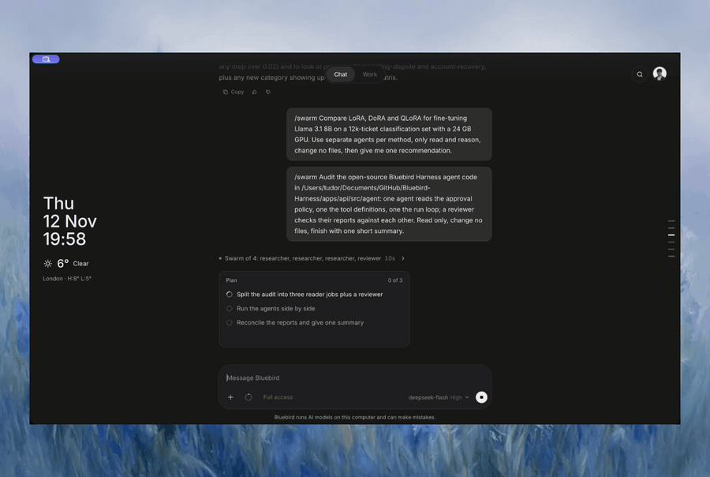
  <br><sub><code>/swarm</code>: وكلاء متخصصون يعملون جنبًا إلى جنب على مهمة واحدة.</sub>
</p>

<p align="center">
  <a href="https://www.bluebirdllm.com"></a>
</p>

## تحكم أصيل بالحاسوب لأي تطبيق على جهازك

اكتب `@` لتوجيه Bluebird إلى أي تطبيق مثبّت. يقرأ نافذة التطبيق ويشغّله عبر إجراءات إمكانية الوصول الخاصة بالنظام على macOS وWindows وLinux، فيعمل حتى مع التطبيقات التي لا تملك أي تكامل.

<p align="center">
  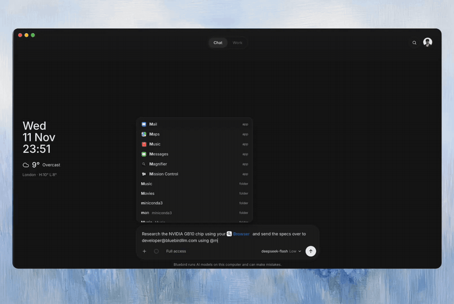
</p>

---

## ماذا يفعل

| | |
| --- | --- |
| **أي محرك** | أكثر من 12 محركًا: Ollama وllama.cpp وvLLM وLM Studio وStrata Engine وOpenAI وAnthropic وDeepSeek وQwen وMistral وGoogle أو أي واجهة API مخصصة. بدّل بينها من قائمة واحدة. |
| **ذاكرة دائمة** | يتذكرك عبر المحادثات، ويبحث في سجل محادثاتك كاملًا، ويتيح لك عرض كل ذكرى وحذفها. |
| **استباقي** | ينفّذ مهامًا مجدولة (`daily 08:30` و`every 30m` وcron) ويتواصل معك عبر Telegram وDiscord وSlack. |
| **التحكم بالحاسوب** | يقرأ تطبيقات سطح المكتب ويشغّلها عبر واجهات إمكانية الوصول. اكتب `@` للإشارة إلى تطبيق. |
| **متصفح خاص به** | يقود متصفح Chromium حقيقيًا: يفتح ويقرأ وينقر ويكتب. ينتج `/research` تقريرًا موثّقًا بالمصادر. |
| **مساعد البرمجة** | يقرأ الشيفرة ويعدّلها وينفّذها، ويعرض معاينة مباشرة لـ HTML وSVG، ولكل تغيير زر تراجع. |
| **السرب والمهارات** | يوزّع `/swarm` المهمة على أربعة وكلاء كحد أقصى. تُحسّن المهارات نفسها بنفسها وتُثبَّت من كتالوجات Claude Code وCodex. |
| **التحكم بيدك** | اسأل دائمًا، أو تلقائي، أو وصول كامل. تستمع واجهة API على loopback فقط، ولا تغادر مفاتيحك حاسوبك أبدًا. |
| **خوادم الأدوات (MCP)** | اربط أي خادم MCP وستظهر أدواته في المحادثة. |
| **مرئيات تفاعلية** | يجيب بمنزلقات ومخططات ومشاهد ثلاثية الأبعاد ورسوم توضيحية وتطبيقات مصغّرة حية بدلًا من جدران النص. |

<table>
<tr>
<td width="50%" align="center">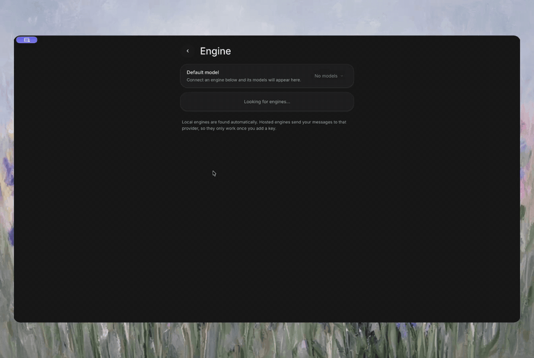<br><sub><b>أي محرك</b></sub></td>
<td width="50%" align="center">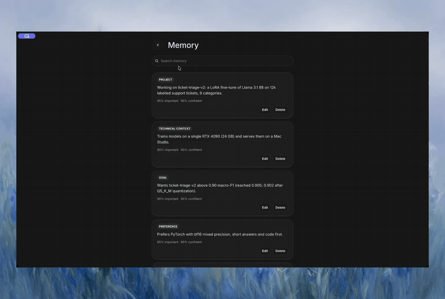<br><sub><b>ذاكرة دائمة</b></sub></td>
</tr>
<tr>
<td width="50%" align="center">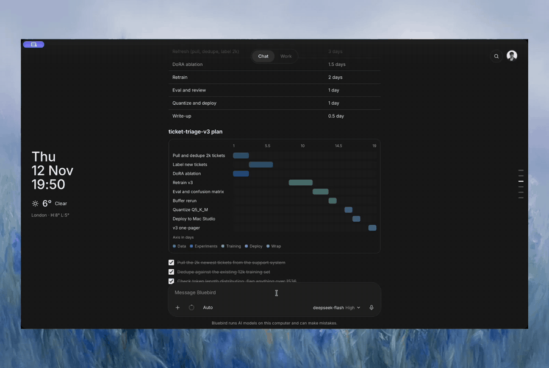<br><sub><b>استباقي</b></sub></td>
<td width="50%" align="center">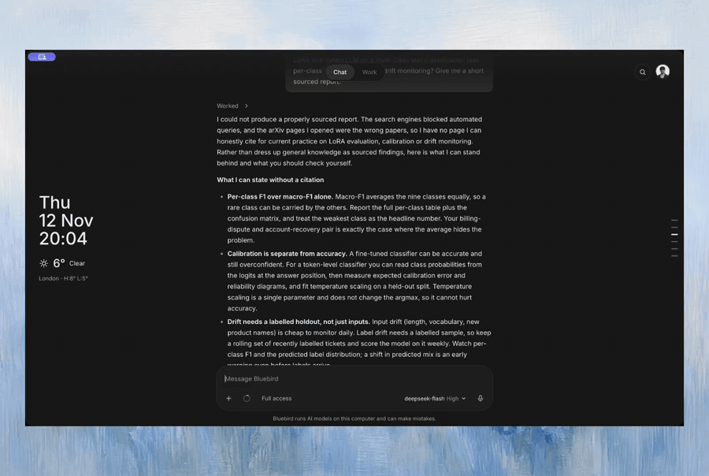<br><sub><b>متصفح خاص به</b></sub></td>
</tr>
<tr>
<td width="50%" align="center">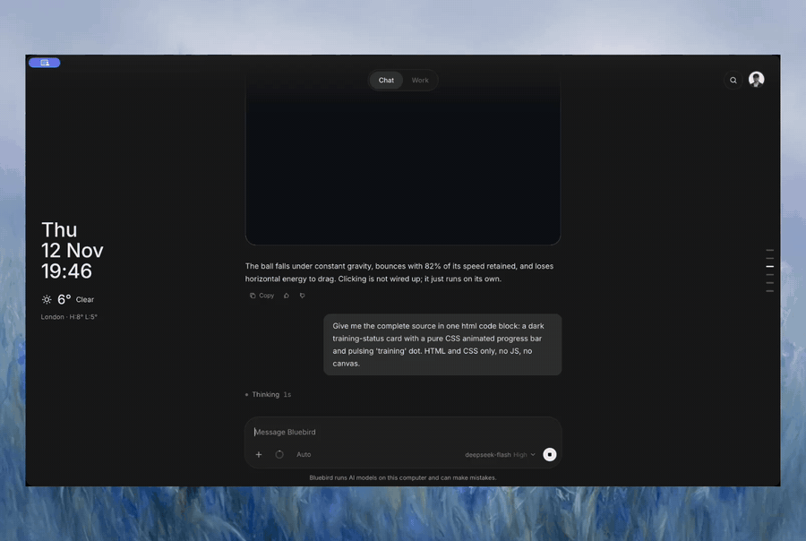<br><sub><b>مساعد البرمجة</b></sub></td>
<td width="50%" align="center">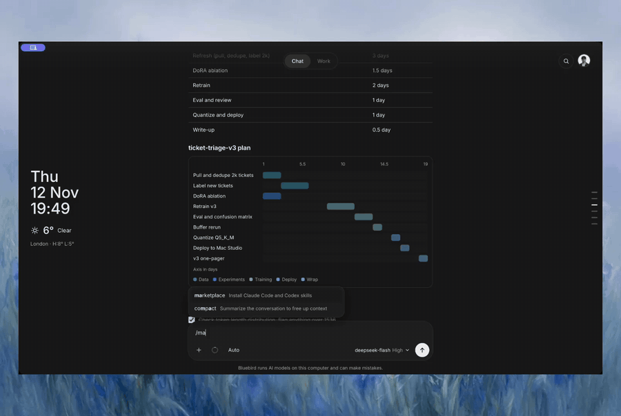<br><sub><b>السرب والمهارات</b></sub></td>
</tr>
<tr>
<td width="50%" align="center">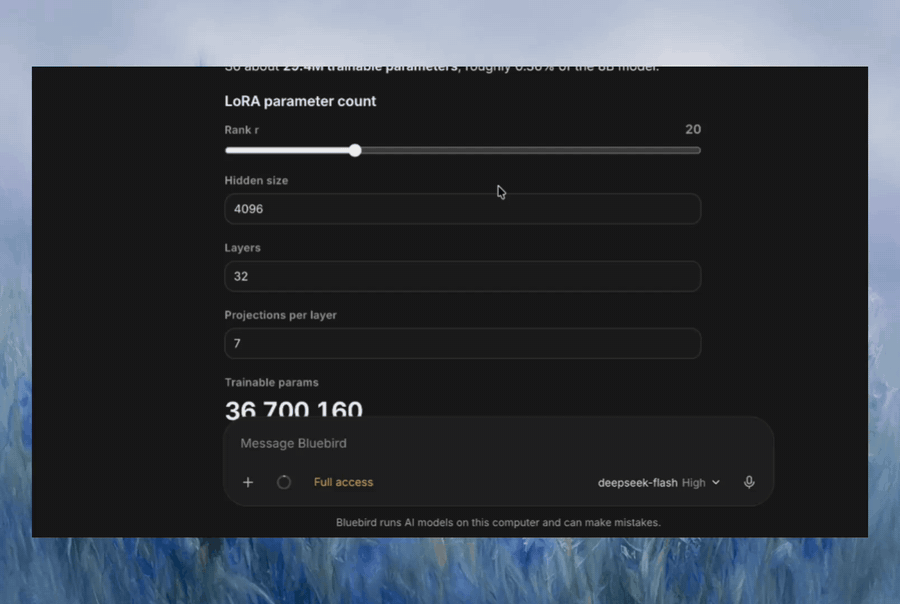<br><sub><b>التحكم بيدك</b></sub></td>
<td width="50%" align="center">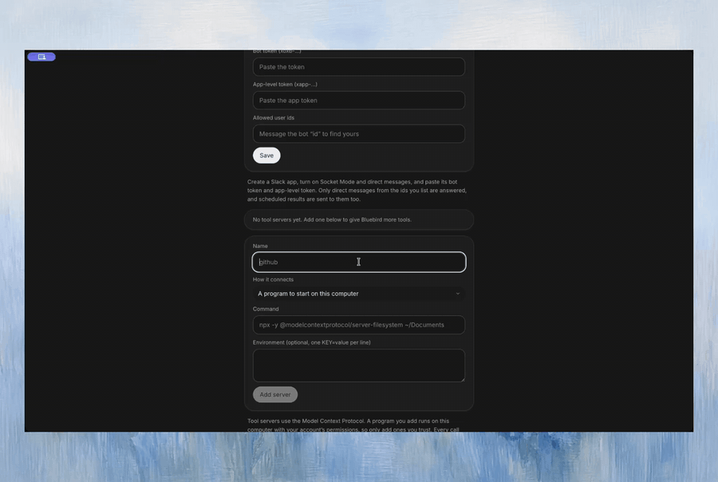<br><sub><b>خوادم الأدوات (MCP)</b></sub></td>
</tr>
<tr>
<td width="50%" align="center">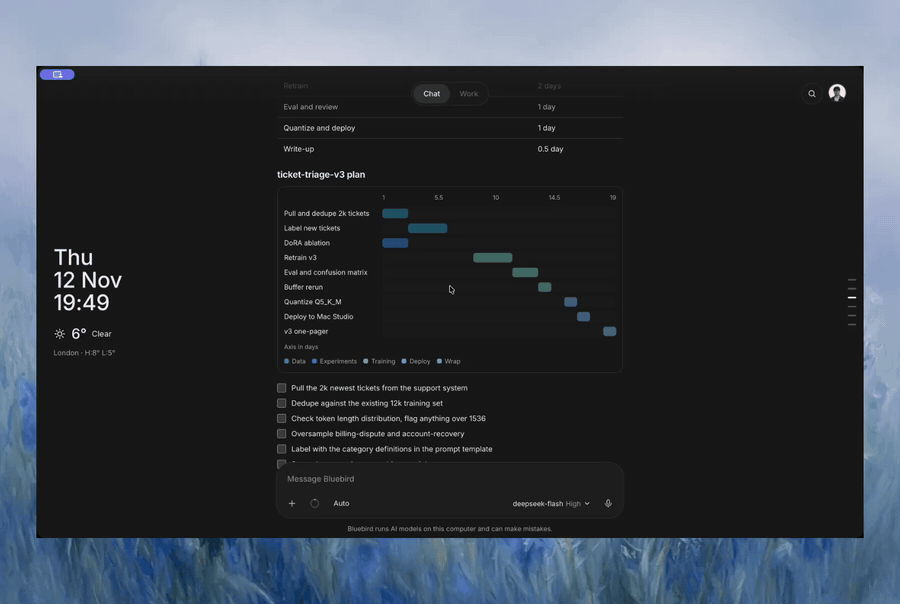<br><sub><b>مرئيات تفاعلية</b></sub></td>
<td width="50%" align="center">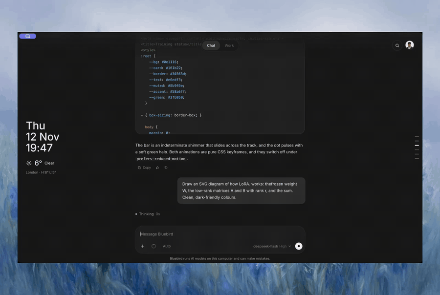<br><sub><b>مرئيات تفاعلية</b></sub></td>
</tr>
</table>

---

## المحركات المدعومة

تُكتشف المحركات المحلية تلقائيًا. تحتاج المحركات المستضافة إلى مفتاح تضيفه بنفسك.

| محلية | مستضافة | مخصصة |
| --- | --- | --- |
| Ollama, llama.cpp, vLLM, LM Studio, Strata Engine | OpenAI, Anthropic, DeepSeek, Qwen, Mistral, Google | Chat Completions API |

## كيف يعمل

كل شيء يعمل على حاسوبك. تُحفظ المحادثات والذاكرة والمرفقات في قاعدة بيانات PostgreSQL محلية وخاصة. لا تُستخدم المحركات المستضافة إلا إذا أضفت مفتاحك الخاص.

```text
Browser / Desktop -> Next.js web app (localhost:3000) -> Fastify API (127.0.0.1:4000)
                                                            |-> PostgreSQL (local)
                                                            |-> Ollama and other engines
```

## التشغيل من المصدر

يتطلب Node 22+ وpnpm وPostgreSQL 17 و[Ollama](https://ollama.com). أو شغّل `bash scripts/install.sh`. ثم افتح <http://localhost:3000>.

```bash
pnpm install && pnpm setup:keys && pnpm db:up && pnpm db:migrate
pnpm dev:api    # terminal 1
pnpm dev:web    # terminal 2
```

📖 [الوثائق الكاملة](../../docs/DOCUMENTATION.md)

---

## ادعم المشروع

إذا كان Bluebird مفيدًا لك، يمكنك [أن تشتري لي فنجان قهوة](https://buymeacoffee.com/tudoriustin_) أو متابعتي على [X](https://x.com/tudoriustin_) و[Hugging Face](https://huggingface.co/tudor-iustin22).

## License

مرخّص بموجب Apache License 2.0. من تطوير Tudor Iustin. See [LICENSE](../../LICENSE).

</div>
